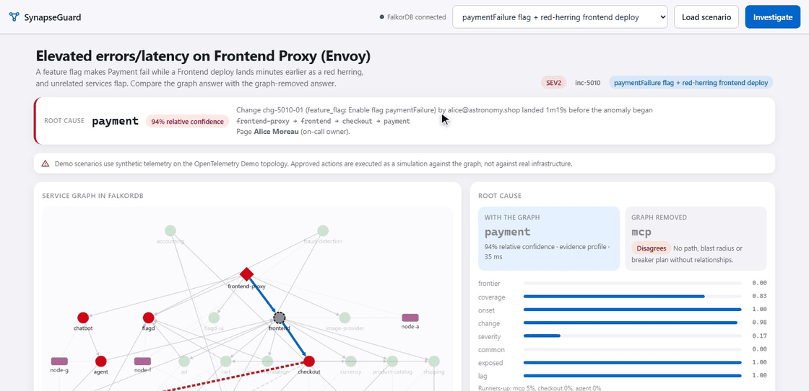
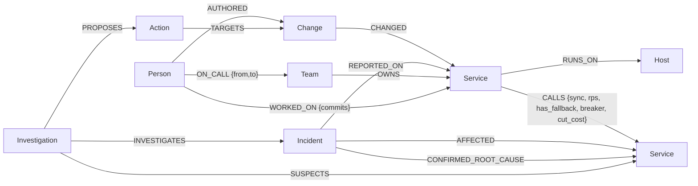

# SynapseGuard

[](https://github.com/Mohit-shirke/synapseguard/actions/workflows/ci.yml)
[](https://mohit-shirke.github.io/synapseguard/)
[](docker-compose.yml)
[](LICENSE)

**An incident agent that finds where a microservice failure started by following the call graph in FalkorDB, explains why with graph evidence, and proposes containment a human can approve.**

Graph Hacks: Context for AI Agents (WeMakeDevs × FalkorDB), **Track 01: Agents That Act on Connected Data** (only).
Team **Night Hunter**: Mohit Sachin Shirke (solo entry).



## What sets it apart

* **It finds the root cause, not only the impact**, and that is measured. On 500 held-out
  synthetic incidents it ranks the true cause first **95.2%** of the time, against **81.6%** for the
  same signals with the graph's relationships removed (tuned identically).
* **Tested on real fault injection, not only our own data.** **645** real cases from three
  microservice systems (RCAEval RE1 + held-out RE2), with the published BARO method run on the same
  cases. Train Ticket's call graph is **learned from 574,479 real Jaeger spans**; Online Boutique's
  hand-written graph was **validated against real traces** (every observed edge present). The result
  is reported as it is, including where the graph does not help.
* **FalkorDB does the reasoning, and we pushed it hard enough to find bugs.** `algo.maxFlow`
  (breaker min-cut), `algo.SPpaths`, `algo.pageRank`, `GRAPH.RO_QUERY`, index-backed hop expansion;
  two FalkorDB 6.0.2 bugs isolated with minimal reproductions ([docs/upstream-issues.md](docs/upstream-issues.md)).
* **The agent never writes a query.** A fixed catalogue of human-written graph tools over MCP,
  names resolved against the graph, four explicit answer types ("not in the graph" is not "safe").
  A local LLM picks the right tool **12/12** with no cloud API.
* **It knows when it is guessing.** When it reports ≥95% confidence it is right **98.1%** of the time;
  it is confidently wrong (≥80% and wrong) on **3.2%** of held-out incidents, and every answer below
  90% is flagged for a second look.

## Demo video

**Video (2:49):** [synapseguard-demo.mp4](https://github.com/Mohit-shirke/synapseguard/releases/download/v1.0.0/synapseguard-demo.mp4),
a narrated walkthrough recorded on the live app. Script, timestamps and the source of every number:
[docs/demo-script.md](docs/demo-script.md).

**Try it in the browser:** <https://mohit-shirke.github.io/synapseguard/>: a recorded demo of the real
UI replaying responses captured from the running app (all five scenarios, investigations, Ask
chips). Approve/execute and the local LLM need the live app: `docker compose up -d --build`.

## The problem

When a request path breaks, the alert fires on the front door (proxy 5xx,
frontend latency), but the cause is usually a few calls away: a bad flag on
Payment, a slow database, a saturated node. Telemetry and change logs live in
separate tools, so the first minutes of an incident go into reconstructing *who
calls whom* and *what changed when*.

## What SynapseGuard does

Given an incident on service `S`, the agent:

1. **Follows the graph.** It extracts the *anomalous subgraph* from FalkorDB:
   synchronous `CALLS` edges from `S` into unhealthy (or unobserved) services,
   one index-backed Cypher query per hop. Degraded services that cannot reach
   the symptom are pruned.
2. **Scores evidence** for each candidate. Is anything below it degraded? How much
   of the subgraph does it explain? Did it degrade first, with callers following
   within 300 s? Did a deploy, config or feature-flag change land just before?
   Do several degraded services share a saturated host?
3. **Explains** the top candidates with evidence items that cite graph elements:
   the call path, blind spots (missing telemetry), timestamps, the change record.
4. **Acts on the structure.** It computes the blast radius, and places circuit
   breakers with FalkorDB's **`algo.maxFlow`**. The minimum cut is taken over a
   cost model computed in Cypher, under the constraint of which clients can actually
   circuit-break. It then proposes rollback / drain / breakers; **a human approves**;
   execution is simulated against the graph.
5. **Knows who to wake.** Teams, owners, weekly on-call rotations, commit history
   and change authors live in the same graph. The agent pages the on-call owner of the
   root cause and the author of the incriminating change, each with the path that justifies it
   (`Alice → ON_CALL → team-checkout → OWNS → payment`).
6. **Remembers.** Investigations, proposals and *human-confirmed* root causes stay
   in the graph. Later incidents recall similar ones by Jaccard overlap in Cypher.
7. **Answers with a fixed tool catalogue, over MCP.** `blast_radius`, `who_to_page`,
   `recent_changes`, `path_between` (**`algo.SPpaths`**), `load_bearing` (**`algo.pageRank`**),
   `recall`, `investigate_incident`. A person wrote every query; a model only picks a tool
   and fills arguments. Every name is **resolved against the graph** first ("Postgres" →
   `postgresql`), and every answer has one of four outcomes: *answered with path*,
   *answered from memory*, *not in the graph*, *unknown entity*. Free-form Cypher is off by
   default; no tool can approve actions. [docs/mcp.md](docs/mcp.md)

An LLM is **optional**. A local model (Ollama `llama3.1:8b`) can answer free-text
questions by **choosing tools over MCP**; its sentence is rejected if it names any
service, person or change the tools did not return. On 12 questions covering every tool
(including a misspelled service, an unknown one and an unconnected pair), it picked the right
tool **12/12**, its answer contained the expected fact **12/12**, and its own sentence passed
the grounding check **12/12**; p50 15.9 s on CPU ([bench/results/llm_agent.json](bench/results/llm_agent.json)).
That is a small, self-written question set, and the check verifies names, not every claim:
in one answer the model listed load-bearing services in its own order rather than PageRank's.

## Results (measured; raw outputs in `bench/results/`)

**Synthetic incidents, held-out test seeds.** Weights are tuned on separate validation seeds for every tuned method:

| Method (OTel Demo topology, 500 test incidents) | Uses | Top-1 | Top-3 |
|---|---|---:|---:|
| **SynapseGuard** | FalkorDB graph | **0.952** | **0.994** |
| Same signals, relationships removed (tuned) | rows only | 0.816 | 0.958 |
| Personalised PageRank (MicroRCA-style) | graph | 0.464 | 0.716 |
| Previous SynapseGuard heuristic ("deepest failing") | graph | 0.254 | 0.586 |
| Blame the alerting service | rows only | 0.086 | 0.086 |

On generated 300-service meshes: **0.960** top-1. Cypher traversal vs a pure-Python reference: **0 mismatches** over 1,250 scenarios.

**Real fault injection, RCAEval** (Pham et al.; 645 cases; Online Boutique (OB), Sock Shop (SS),
Train Ticket (TT); Avg@5; Z=10 fixed in advance; RE2 held out). TT's call graph is learned
from real traces:

| Avg@5 | RE1-OB | RE1-SS | RE1-TT | RE2-OB | RE2-SS | RE2-TT |
|---|---:|---:|---:|---:|---:|---:|
| SynapseGuard (product default) | **0.845** | **0.875** | 0.624 | 0.904 | 0.938 | 0.698 |
| No-graph robust-z scorer (same harness) | 0.821 | 0.854 | **0.629** | **0.922** | **0.942** | **0.740** |
| Official BARO (FSE'24), run with RCAEval's code | 0.90 | 0.74 | 0.58 | 0.60 | 0.63 | 0.73 |

**Read this honestly:** on real, metrics-only telemetry the graph's *ranking* is
on par with a strong no-graph scorer: better on RE1 OB/SS, a tie on RE1-TT and
worse on held-out RE2 (−4 points on Train Ticket, where the true cause was reachable
through degraded calls in only 87% of cases). With evidence weights learned on the *other*
real systems (leave-one-system-out), the graph scorer beats the no-graph scorer on 4 of 6
held-out system-suites; we report that, but did not switch the product default after seeing it. RCAEval has no change log or host placement, which is where the
graph's ranking advantage comes from in the synthetic benchmark. Full analysis,
including the bug that real data exposed: [docs/evaluation.md](docs/evaluation.md).

**Latency** (local Docker FalkorDB 6.0.2, Windows laptop): full investigation p50
(including who-to-page) **47 ms** at 100 services, **70 ms** at 1,000, **260 ms** at
10,000 services / 24,656 calls, where max-flow over the whole mesh dominates. An
investigation issues about 25 small queries, so latency tracks the database round trip
(0.9 ms p50 in this run; an earlier run on the same laptop with a faster Docker network
path measured about 2.5× lower). [bench/results/scale.md](bench/results/scale.md)

## Quick start

Requirements: Docker; Python 3.12 for local runs.

```bash
docker compose up -d --build          # FalkorDB 6.0.2 + API; UI at http://localhost:8000
```

Or run the API locally:

```bash
docker compose up -d falkordb
python -m venv .venv && .venv\Scripts\activate      # Windows (source .venv/bin/activate on Linux/macOS)
pip install -r requirements-dev.txt
set PYTHONPATH=.                                    # export PYTHONPATH=. on Linux/macOS
uvicorn synapseguard.api.app:app --port 8000
```

Open <http://127.0.0.1:8000>, pick a scenario, **Load scenario**, **Investigate**, then try
the **Ask the graph** chips (depth 1 vs depth 4, an unknown service).
FalkorDB Browser: <http://localhost:3001>.

```bash
python -m pytest tests -q                 # 138 tests, needs FalkorDB on localhost:6379
python -m scripts.mcp_smoke               # MCP over stdio, end to end
python -m bench.eval_llm_agent            # local LLM tool selection (needs Ollama + llama3.1:8b)
python -m bench.eval_accuracy             # synthetic accuracy (~70 s)
python -m bench.bench_scale               # 100 / 1k / 10k services
python -m scripts.prepare_rcaeval && python -m bench.eval_rcaeval --suite re1 --data bench/data/rcaeval
docker compose down                       # stop (add -v to delete the graph volume)
```

MCP client setup: [docs/mcp.md](docs/mcp.md).

## Graph data model



Properties, indexes and **every Cypher query the product depends on** are in
[docs/graph-model.md](docs/graph-model.md). The algorithm, pseudocode and complexity
are in [docs/algorithm.md](docs/algorithm.md); the architecture is in
[docs/architecture.md](docs/architecture.md).

## Demo scenarios

Five deterministic scenarios on the OpenTelemetry Demo topology, modelled on its
official fault-injection flags: `payment-flag` (flag plus a red-herring deploy),
`silent-db` (no change record), `noisy-neighbour` (saturated node),
`catalog-lock` (retry storm), `quote-no-breaker` (callers can't circuit-break).
Telemetry is synthetic; the topology follows the public OTel Demo architecture.

## How this differs from the organisers' example

The organisers' article *How to Build an Agent That Reasons Over a Graph* builds
"Blast Radius": impact, on-call and recent changes for a downed service. SynapseGuard
follows the same principles (fixed tools, name resolution, paths with every answer,
memory as nodes) and adds what an incident actually needs next: **which service is the
root cause**, with an evidence model measured on 1,250 synthetic and 645 real
fault-injection cases; **min-cut circuit-breaker placement**; and a **human-approved
action lifecycle**. Mapping: [docs/design-alignment.md](docs/design-alignment.md).

## Why FalkorDB here

* Reachability with per-hop predicates, evaluated next to the data, as tools an agent calls every step.
* `algo.maxFlow` for breaker placement; the cost model is computed in Cypher.
* `GRAPH.RO_QUERY` gives LLM agents a database-enforced read-only boundary.
* One persistent graph shared by the web agent and MCP clients is the memory; `select_graph` isolates environments.

We don't claim speed over an in-memory graph at incident scale: our tests compute
the same traversals with networkx to check the Cypher.

## Engineering notes

* Two FalkorDB 6.0.2 bugs found by our tests (a server panic and a wrong-result
  query shape), with minimal reproductions and workarounds:
  [docs/known-issues.md](docs/known-issues.md).
* `WHERE n.id IN $list` instead of `UNWIND … MATCH ({id:x})` makes FalkorDB use the
  index (verified with `GRAPH.EXPLAIN`): about 3.6× faster investigations at 1,000 services.
* Limitations are listed in [docs/known-issues.md](docs/known-issues.md).

## Repository layout

```
synapseguard/core      config, FalkorDB access (timeouts, read-only queries)
synapseguard/data      OTel topology, seeded scenario generator, validated loader, demo scenarios
synapseguard/engine    rca, baselines, containment, actions, recall (memory), narrator, investigator
synapseguard/api       FastAPI app        synapseguard/web    UI (single page)
synapseguard/mcp_server.py                MCP tools
bench/                 accuracy, real-world (RCAEval) and scale benchmarks + results
tests/                 pytest suite (live FalkorDB)         docs/   design, evaluation, demo script
```

## AI assistance disclosure (Rule 11)

AI coding assistants were used during development. Mohit Shirke is responsible for the
code, the graph model and the design decisions; [docs/walkthrough.md](docs/walkthrough.md)
explains them.

## Reproducibility

Every number in this README comes from scripts in `bench/` that can be re-run; raw
outputs are in `bench/results/`. A guided tour of the code: [docs/walkthrough.md](docs/walkthrough.md).

## License

MIT (see `LICENSE`). Third-party components and data: [THIRD_PARTY_NOTICES.md](THIRD_PARTY_NOTICES.md).
