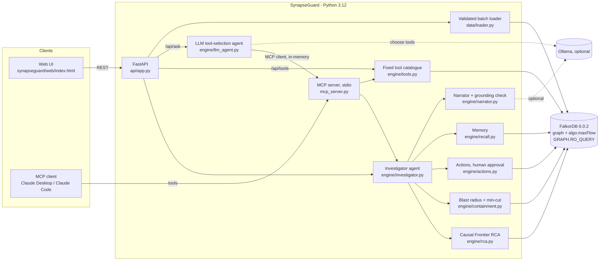

# Architecture

## Request flow: `POST /api/incidents/{id}/investigate`

1. `get_incident` reads the incident and its reported service.
2. `extract_anomalous_subgraph` runs a hop-by-hop BFS in FalkorDB over
   synchronous calls into degraded or unknown services.
3. `score_candidates` computes the evidence features and picks a scoring profile
   from data availability.
4. `recall_similar_incidents` writes the `Investigation` and `AFFECTED`
   edges, then finds overlapping past incidents.
5. `blast_radius` runs an upstream BFS from the root.
6. `breaker_min_cut` runs `algo.maxFlow` over `cut_cost`, then computes the
   residual min-cut in Python.
7. `who_to_page`: on-call owner at the incident time, change authors, people with history.
8. `propose_actions`: rollback, breakers, drain host, page, plus advisories; all mutating
   actions are `PROPOSED`.
9. `narrate` builds a template narrative; an optional LLM rewrite is accepted only
   if it passes the grounding check.

Every step is timed and returned as the `trace`, which the UI shows.

## Why a graph database, and why FalkorDB here

What the product needs from storage:

* multi-hop reachability with per-hop predicates on node and edge properties
  (anomalous subgraph, blast radius), evaluated where the data is;
* graph algorithms callable as tools (`algo.maxFlow` for breaker placement);
* a query language an LLM can use, with a **server-enforced read-only mode**
  (`GRAPH.RO_QUERY`) so the agent's own Cypher cannot mutate state;
* persistent, shared state for memory, readable by the web agent and by any MCP
  client at the same time; and cheap isolated graphs per environment or tenant
  (`select_graph`).

What we do **not** claim: at the incident sizes here an in-memory Python graph
(networkx) computes the same traversals. Our tests do exactly that to check the
Cypher (`reference_subgraph`). The value of FalkorDB is persistence, concurrency,
the read-only tool boundary, built-in algorithms and the shared memory graph,
not raw speed on small graphs. A relational database could store the same rows.
The "graph removed" mode shows what the product can still do from rows alone:
rank by flat signals, with no path, blast radius or breaker plan.

## Failure handling

| Failure | Behaviour |
|---|---|
| FalkorDB down at start or mid-request | `GraphUnavailable` → HTTP 503; `/health` reports degraded; Docker healthcheck gates the API |
| Slow or pathological query | per-query server-side timeout (`SG_QUERY_TIMEOUT_MS`) |
| Invalid ingest payload | validated before any write → HTTP 422 |
| LLM unreachable / malformed / ungrounded output | template narrative, violations reported |
| Unknown incident/action | HTTP 404; invalid state transition → 400 |
