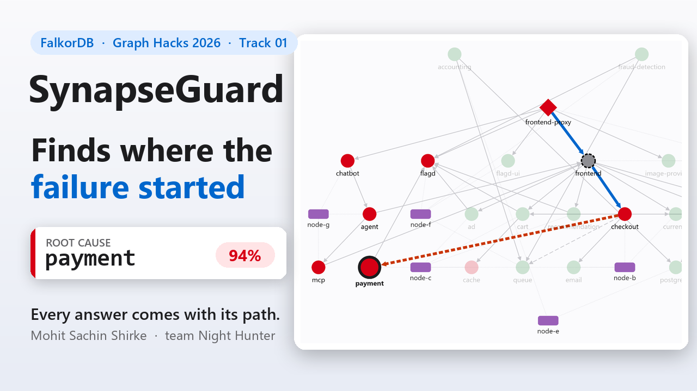

# What a graph actually buys an incident agent (and what it doesn't)

*By Mohit Sachin Shirke (team Night Hunter), for Graph Hacks: Context for AI Agents (WeMakeDevs × FalkorDB), Track 01.*

A smoke alarm tells you there is a fire, but never which room it started in.

Microservice alerts work the same way. When checkout breaks, the alert fires at the front door: the
proxy returns errors and the frontend's latency spikes. The cause is usually somewhere those services
call, two or four hops down. On-call engineers spend the first, most expensive minutes working out
who calls whom, what changed, and who owns the broken thing.

For Graph Hacks I built **SynapseGuard**, an incident agent that walks from the alarm to the room
where the fire began and shows every step. I wanted to find out how much a graph database really
helps an agent do that, so I measured it, including on data I didn't make up.

* Demo video (2:49): https://youtu.be/mOSek0RKldQ
* Try it in the browser: https://mohit-shirke.github.io/synapseguard/
* Code, benchmarks and raw results: https://github.com/Mohit-shirke/synapseguard

## The agent's whole context is one graph

Everything the agent knows lives in FalkorDB:
- the service call graph (the OpenTelemetry Demo's real topology), with live telemetry on each service;
- which host each service runs on;
- the change log: deploys, config changes and feature flags;
- the people: teams, owners, on-call rotations, who authored each change and who has worked on what;
- the agent's own memory of past incidents and the actions it proposed.

When an incident arrives, the agent does five things that a table of rows can't.

1. **It prunes by reachability.** It follows synchronous `CALLS` edges from the alerting service, but
   only into unhealthy services, one hop at a time, with one index-backed Cypher query per hop. A
   database that is broken but unreachable from the symptom isn't the cause of *this* symptom.
2. **It scores candidates on evidence.** Inside that subgraph it asks: does anything below a candidate
   explain it? How much of the degradation does the candidate explain? Did it degrade first, and did
   its callers follow within a minute? Did a change land just before? Do several broken services share
   a saturated host?
3. **It names who to page, with proof.** Every person comes with a graph path, for example
   `p-alice → ON_CALL → team-checkout → OWNS → payment`, plus the author of the change.
4. **It acts on the structure.** It computes the blast radius and runs FalkorDB's `algo.maxFlow` to
   place the cheapest circuit breakers that cut users off from the fault.
5. **It waits for a human.** Every action needs a person to approve it and then execute it. When the
   agent isn't sure, it says so and flags the answer for verification.

In the demo, a feature flag breaks the payment service while an unrelated frontend deploy lands as a
red herring. One click gives: root cause **payment**, at 94% relative confidence. The flag landed
79 seconds before payment degraded. Page **Alice**, the on-call owner.

## Give the LLM graph tools, not graph access

The same capabilities are exposed as an MCP server, but as a **fixed catalogue of human-written,
parameterised Cypher tools**: `blast_radius`, `who_to_page`, `path_between`, `recent_changes`, and
so on. Names are resolved against the graph before any query runs. Ask about `payments-gateway`, which
doesn't exist, and no query runs: the agent replies that the name isn't in the graph and asks whether
you meant `payment`. Free-form Cypher is off by default, and no tool can approve an action.

A small local model (llama3.1:8b on a CPU) chose the right tool for 12 of 12 test questions. Its final
sentence is rejected if it names anything the tools didn't return.

## The results I expected, and the ones I got

On 500 held-out synthetic incidents, with decoys, red-herring deploys and missing telemetry, the graph
agent ranked the true root cause first **95.2%** of the time. The strongest rows-only baseline, with
the same signals, the same tuning and the relationships removed, managed **81.6%**. The first version
of my own project, which simply picked the "deepest failing service", managed **25%**.

Then I ran it on **RCAEval**, a public benchmark of real fault injection: 645 cases across Online
Boutique, Sock Shop and Train Ticket, with metrics from real clusters but no change logs and no host
placement. For Train Ticket I learned the call graph from 574,479 real Jaeger spans; on Online
Boutique, the same method confirmed every edge of my hand-written graph.

The honest result: with my default settings, the graph's ranking is **on par** with a strong no-graph
scorer. It's better on some systems and worse on others, including 4 points worse on held-out Train
Ticket. With weights learned on the *other* real systems, the graph scorer won on 4 of 6 held-out
system-suites, but I didn't switch the product default after seeing those results. The graph's ranking
advantage comes from joining telemetry with changes and placement, and RCAEval doesn't have those
joins, so there was nothing for the graph to exploit.

Real data also caught a bug that synthetic data never would have: a severity score that saturated at
1.0 and stopped telling services apart.

## Two FalkorDB bugs, found along the way

Pushing FalkorDB 6.0.2 hard turned up two issues, both reproduced in the repo:
- a query shape with two `MATCH … WHERE … IN $list` clauses that silently returns no rows, unless you
  put a `WITH` between the clauses;
- a query with two `OPTIONAL MATCH` clauses, an aggregation and `ORDER BY` that crashed the server.

Two more lessons:
- `WHERE n.id IN $list` uses the index, while `UNWIND … MATCH (n {id: x})` didn't. Switching made
  investigations about 3.6× faster at 1,000 services.
- Results are capped at `RESULTSET_SIZE` (10,000 rows) without a warning, so any query that "returns
  everything" must be bounded.

## What I learned

* **A graph earns its place when the answer depends on joining structure with operational
  context:** calls with changes, placement and time. Remove the relationships and the same signals
  blame the wrong service.
* **Measure on someone else's data.** My synthetic benchmark flattered me; real data told me where the
  graph helps and where it doesn't.
* **Give LLM agents graph tools, not graph write access.** Read-only access belongs in the database
  and the tool design, not in a prompt.
* **Make every answer show its path.** It turns "trust me" into "check me", and that's what an on-call
  engineer at 3 a.m. actually needs.

Every answer comes with its path. The code, the benchmarks and the raw results are all in the
repository: https://github.com/Mohit-shirke/synapseguard
