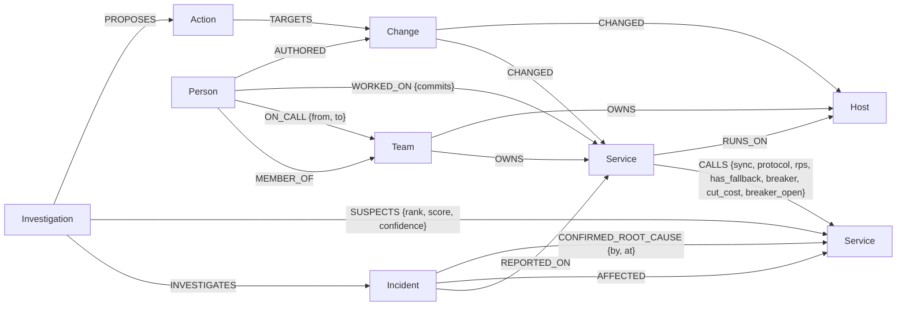

# Graph data model

One FalkorDB graph per environment (default `sg_otel_demo`). Live state
(services, hosts, calls, changes) is replaced when a new snapshot is loaded;
history (incidents, investigations, actions) is kept, which is what gives the
agent memory across sessions.



## Nodes

| Label | Key properties | Notes |
|---|---|---|
| `Service` | `id`, `name`, `kind` (service/proxy/database/cache/queue/flags), `entrypoint`, `criticality`, `error_rate`, `p99_ms`, `base_error_rate`, `base_p99_ms`, `anomaly` (0–1 or null = no telemetry), `onset` (epoch s), `degraded` | `anomaly ≥ 0.2` ⇔ degraded |
| `Host` | `id`, `zone`, `cpu`, `mem`, `saturated` | `saturated = cpu ≥ 90` |
| `Change` | `id`, `kind` (deploy/config/feature_flag/infra), `summary`, `author`, `at`, `param`, `old`, `new`, `rolled_back` | change log of the snapshot |
| `Incident` | `id`, `title`, `severity`, `opened_at`, `status` (OPEN/ARCHIVED/RESOLVED), `scenario` | kept across snapshots |
| `Investigation` | `id`, `at`, `algorithm`, `mode`, `top_id`, `top_confidence` | one per agent run |
| `Team` | `id`, `name` | owns services and hosts (synthetic, fictional) |
| `Person` | `id`, `name`, `email` | fictional people; `email` links to `Change.author` |
| `Action` | `id`, `kind`, `summary`, `risk`, `status` (PROPOSED/APPROVED/REJECTED/EXECUTED_SIMULATED/ADVISORY), `requires_approval`, `refs`, `expected_recovery`, `edges`, `outcome`, `decided_by` | human-in-the-loop lifecycle |

## Relationships

| Type | Direction | Meaning |
|---|---|---|
| `CALLS` | caller → callee | the caller depends on the callee; `sync=false` for fire-and-forget (Kafka publish) |
| `RUNS_ON` | service → host | placement |
| `CHANGED` | change → service/host | what a change touched |
| `REPORTED_ON` | incident → service | where the symptom was reported |
| `AFFECTED` | incident → service | degraded services seen during investigation (memory) |
| `CONFIRMED_ROOT_CAUSE` | incident → service/host | written only by a human |
| `INVESTIGATES`, `SUSPECTS`, `PROPOSES`, `TARGETS` | | investigation trail |
| `MEMBER_OF` | person → team | team membership |
| `OWNS` | team → service/host | ownership |
| `ON_CALL {from, to}` | person → team | weekly rotation windows (epoch s) |
| `WORKED_ON {commits}` | person → service | history, for "who knows this system" |
| `AUTHORED` | person → change | who made a change |

## Indexes

`Service(id)`, `Service(anomaly)`, `Host(id)`, `Change(id)`, `Incident(id)`,
`Investigation(id)`, `Action(id)`, `Person(id)`, `Person(email)`, `Team(id)`, created by `GraphStore.ensure_indexes()`.
Hot-path lookups use `WHERE n.id IN $list` so that FalkorDB plans a
`Node By Index Scan` (checked with `GRAPH.EXPLAIN`).

## Cypher the product depends on

All are parameterised; nothing user-supplied is concatenated into Cypher.

**Anomalous subgraph, one BFS hop** (`synapseguard/engine/rca.py`)
```cypher
MATCH (a:Service) WHERE a.id IN $frontier
WITH a
MATCH (a)-[r:CALLS]->(b:Service)
WHERE r.sync = true AND (b.anomaly IS NULL OR b.anomaly >= $tau)
RETURN a.id, b.id, r.protocol, r.rps, r.has_fallback
```

**Co-located services per host** (common-cause evidence)
```cypher
MATCH (h:Host) WHERE h.id IN $hids
WITH h
MATCH (h)<-[:RUNS_ON]-(s:Service)
RETURN h.id, h.cpu, h.mem, collect([s.id, s.anomaly, s.onset])
```

**Changes on the subgraph**
```cypher
MATCH (c:Change)-[:CHANGED]->(t)
WHERE (t:Service AND t.id IN $sids) OR (t:Host AND t.id IN $hids)
RETURN c.id, c.kind, c.summary, c.at, c.author, c.param, c.old, c.new, t.id, labels(t)[0]
```

**Blast radius, one upstream hop** (`synapseguard/engine/containment.py`)
```cypher
MATCH (b:Service) WHERE b.id IN $frontier
WITH b
MATCH (a:Service)-[r:CALLS]->(b)
RETURN b.id, a.id, r.sync, a.entrypoint, a.criticality, a.degraded
```

**Breaker cost model, computed in the graph** (`synapseguard/data/loader.py`)
```cypher
MATCH (a:Service)-[r:CALLS]->(b:Service)
OPTIONAL MATCH (b)-[:CALLS]->(c:Service) WHERE c.degraded = false
WITH r, b, count(c) AS healthy_fanout
SET r.cut_cost = CASE WHEN r.breaker
    THEN toInteger(r.rps * (1 + healthy_fanout) * CASE WHEN b.degraded THEN 1 ELSE 10 END)
    ELSE 1000000 END
```

**Minimum-cost breaker placement with FalkorDB's max-flow**
```cypher
MATCH (s:Service) WHERE s.id IN $sources
WITH collect(s) AS src
MATCH (t:Service) WHERE t.id IN $sinks
WITH src, collect(t) AS dst
CALL algo.maxFlow({sourceNodes: src, targetNodes: dst, capacityProperty: 'cut_cost',
                   relationshipTypes: ['CALLS'], nodeLabels: ['Service']})
YIELD edges, edgeFlows, maxFlow
RETURN [e IN edges | [startNode(e).id, endNode(e).id]], edgeFlows, maxFlow
```

**Memory: similar past incidents by Jaccard overlap of affected services** (`synapseguard/engine/recall.py`)
```cypher
MATCH (cur:Incident {id: $id})-[:AFFECTED]->(s:Service)
WITH cur, collect(s.id) AS cur_ids
MATCH (past:Incident)-[:AFFECTED]->(ps:Service) WHERE past.id <> cur.id
WITH cur_ids, past, collect(ps.id) AS past_ids
WITH past, past_ids, [x IN past_ids WHERE x IN cur_ids] AS shared, cur_ids
WITH past, size(shared) AS n_shared, size(cur_ids) + size(past_ids) - size(shared) AS n_union
...
```

**Read-only tool for LLM agents** (`synapseguard/mcp_server.py`): arbitrary
Cypher through `GRAPH.RO_QUERY`, which FalkorDB rejects for any write clause.

**Who to page** (`synapseguard/engine/tools.py`): on-call owner at the incident time, plus recent change authors
```cypher
MATCH (t:Team)-[:OWNS]->(x:Service {id: $id})
OPTIONAL MATCH (p:Person)-[o:ON_CALL]->(t) WHERE o.from <= $now AND o.to > $now
RETURN t.id, t.name, p.id, p.name

MATCH (p:Person)-[:AUTHORED]->(c:Change)-[:CHANGED]->(x:Service {id: $id})
WHERE c.at <= $now AND c.at >= $now - 7200
RETURN p.id, p.name, c.id, c.summary, c.at ORDER BY c.at DESC
```

**Why are two services connected** (FalkorDB `algo.SPpaths`; `CALLS.weight` = 1 sync, 3 async)
```cypher
MATCH (a:Service {id: $a}), (b:Service {id: $b})
CALL algo.SPpaths({sourceNode: a, targetNode: b, relTypes: ['CALLS'], relDirection: 'outgoing',
                   weightProp: 'weight', pathCount: 1})
YIELD path, pathWeight
RETURN [n IN nodes(path) | n.id], pathWeight
```

**Load-bearing services** (FalkorDB `algo.pageRank`)
```cypher
CALL algo.pageRank('Service', 'CALLS') YIELD node, score
WITH node, score ORDER BY score DESC LIMIT $limit
OPTIONAL MATCH (c:Service)-[:CALLS]->(node)
RETURN node.id, score, collect(c.id)
```
